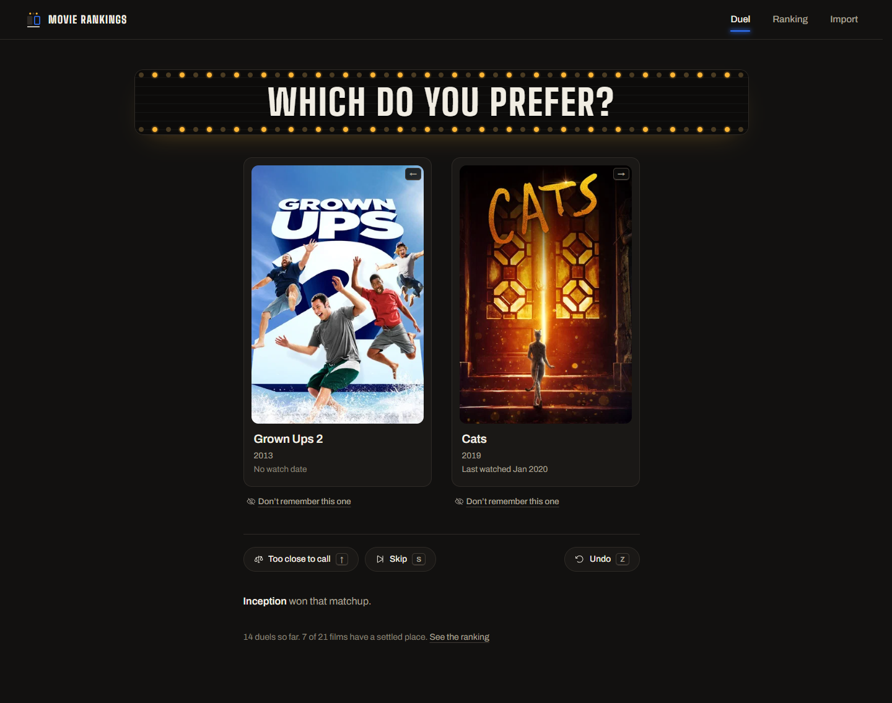
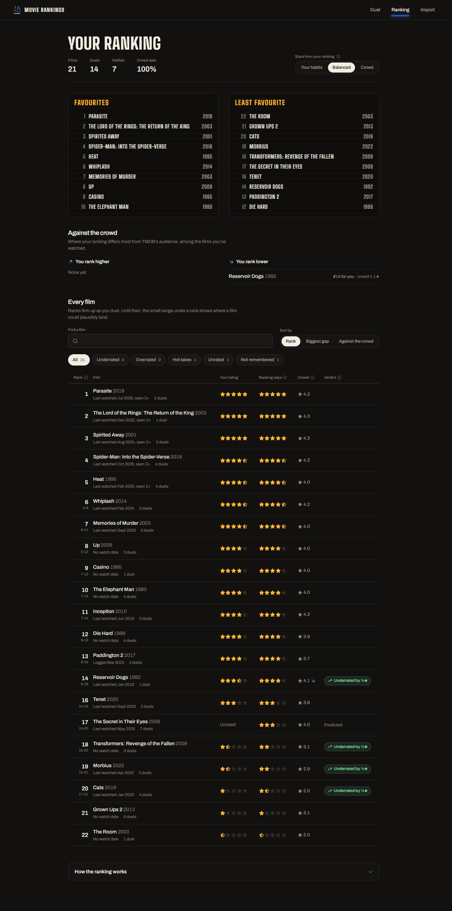
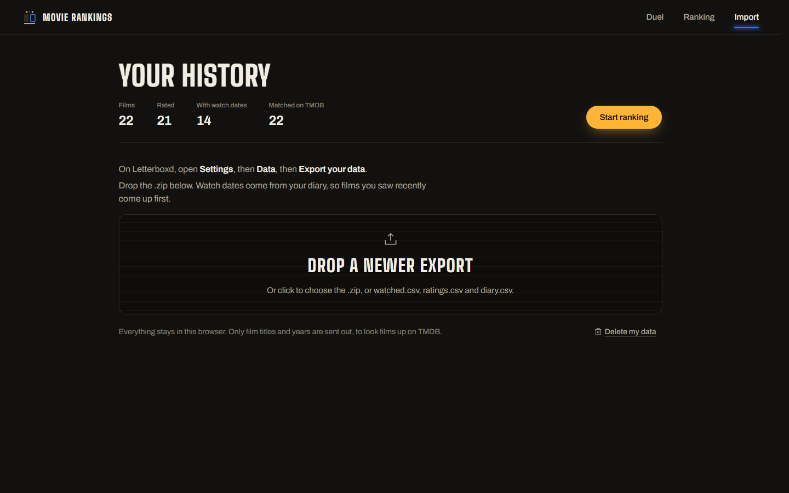
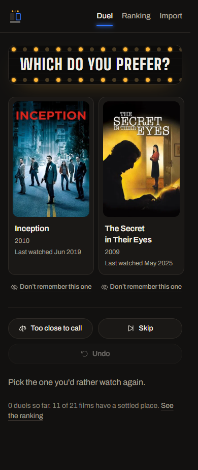

# Movie Rankings v2

Rank every film you've logged on Letterboxd through head-to-head duels, then see where that ranking disagrees with your star ratings and with the crowd. Successor to [Movie-Rankings](https://github.com/ChristianGleitzman/Movie-Rankings), the original PyQt5 version.



## What the program does

- **Imports your whole history.** On Letterboxd go to Settings → Data → Export your data and drop the `.zip` in. The official Letterboxd API is private, so the app reads the export instead. It merges `watched.csv`, `ratings.csv` and `diary.csv`, and everything stays in your browser's localStorage.
- **Asks "Which do you prefer?"** Two films go up on the marquee. Pick one (click, or ← / →) and the app tells you who won that matchup, as v1 did. When the result goes against the model's expectation, it calls it an upset and shows the win chance it had given the winner.
- **Gives you a way out of hard choices.**
  - **Too close to call** (↑) scores the duel as a draw.
  - **Don't remember this one** takes a film out of duels. You can bring it back from the ranking page.
  - **Skip** (S) deals a new pair, and **Undo** (Z) takes back the last action.
- **Uses when you watched each film.** Your diary supplies each film's last watch date and how many times you've seen it, and every card shows them as a memory jog. Matchups favour recent watches. Dates from bulk-import days are ignored, because they don't say when you actually saw a film.
- **Shows your ranking, with honest uncertainty.**
  - The page opens with Favourites and Least favourite boards, a nod to v1's two lists.
  - Every film shows a likely rank range until enough duels settle it.
  - Each film has your stars, the stars your ranking implies, and the crowd's rating.
  - A verdict flags films you've underrated or overrated.
  - "Against the crowd" lists your biggest hot takes.

## How the ranking works

- **Model.** A Bradley-Terry model, P(a beats b) = σ(θa − θb), with a Gaussian prior on each film. The whole duel log is kept, and θ is the maximum a posteriori fit over all of it, solved by Gauss-Seidel Newton steps with a warm start. The log is the source of truth, so the order you duel in doesn't matter, undo just drops the last entry, and the model can change without losing history. A draw counts as half a win for each film.
- **Priors from your stars, read relative to you.** A rating's prior mean is the probit of its mid-quantile within your own ratings. If a fifth of your films are 5★, a 5★ means "your top fifth", not "maximum". This fixes the bias where a generous rater's large block of 5★ films all started at the top, tied.
- **The crowd fills gaps.** Crowd ratings come from TMDB's audience average, with at least 25 votes. They break ties within a star rating with a small weight, and give films you never rated a starting point with a larger one.
- **Uncertainty.** Each film's posterior variance comes from the curvature of the fit (a Laplace approximation). It shrinks as the film is dueled. That variance gives the likely rank range (about 68%) and decides when a film counts as settled.
- **Matchmaking is active learning.**
  - **Film A** is drawn in proportion to its uncertainty, weighted by how recently you watched it.
  - **Film B** is the opponent that maximises the expected information, p(1 − p)·(σa² + σb²), again weighted by recency.
  - **Repeats are limited.** Films from the last few duels sit out, and recent pairings are discounted.
  - Lopsided matchups rarely appear, because they would teach the model almost nothing.
- **Turning the ranking back into stars.** Stars are handed out by position in the ranking, with three scales:
  - **Your habits:** each rating as often as you give it.
  - **Crowd:** how TMDB's audience rates the films you've watched, stretched to an individual's spread.
  - **Balanced (default):** halfway between the two. It reins in a generous rater's 5★ without assuming they watch bad films.
- **Migration.** Progress from the earlier Elo version is converted into a per-film shift on the new prior, so nothing is lost.

The model lives in `lib/model.ts` and is covered by `lib/model.test.ts`.

## Screenshots

_Shown with sample data. Without a TMDB token, posters are replaced by the title on a letterboard and crowd features are hidden._

| Ranking | Import | Duel on a phone |
| --- | --- | --- |
|  |  |  |

## Improvements over v1

v1 ranked a fixed list of films scraped from a movie website, so it would ask about films you'd never seen, and it had no way out of a hard choice. Its README suggested personalising the list. v2 works from your own Letterboxd history. It adds a statistical model with uncertainty, matchups chosen to learn the most, draws, skips, undo and "don't remember", recent-first matchups, and comparisons against both your stars and the crowd.

## Possible improvements

- Share your ranking as an image or a Letterboxd list.
- Genre or decade filters for themed duel sessions.
- Sync between devices (today the ranking lives in one browser).
- Letterboxd's own averages instead of TMDB's, if the Letterboxd API becomes available.

## Built with

Next.js, Tailwind CSS v4 and shadcn/ui (Base UI), with Phosphor icons. Fonts are Big Shoulders and Archivo. This product uses the TMDB API but is not endorsed or certified by TMDB.

## Run

```bash
npm install
cp .env.example .env.local   # optional: add a TMDB read token for posters and crowd ratings
npm run dev
npm test
```
